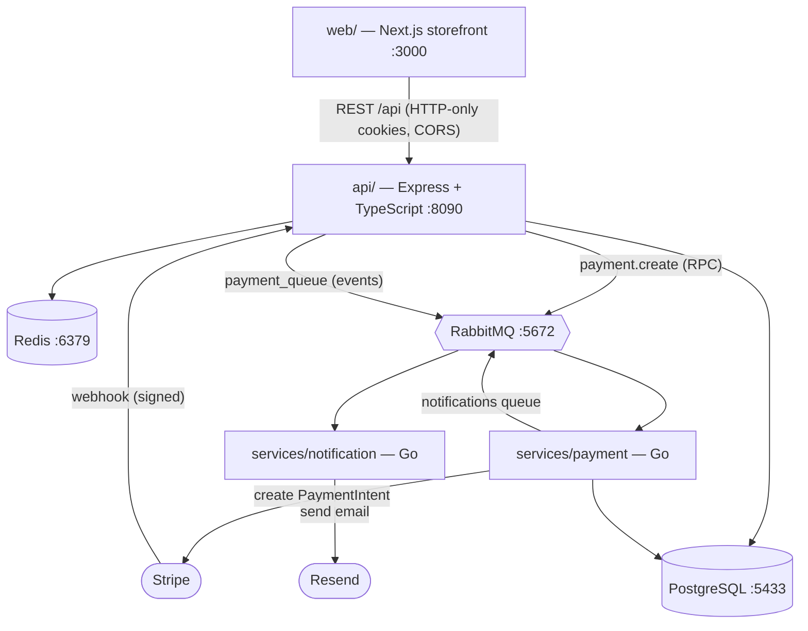
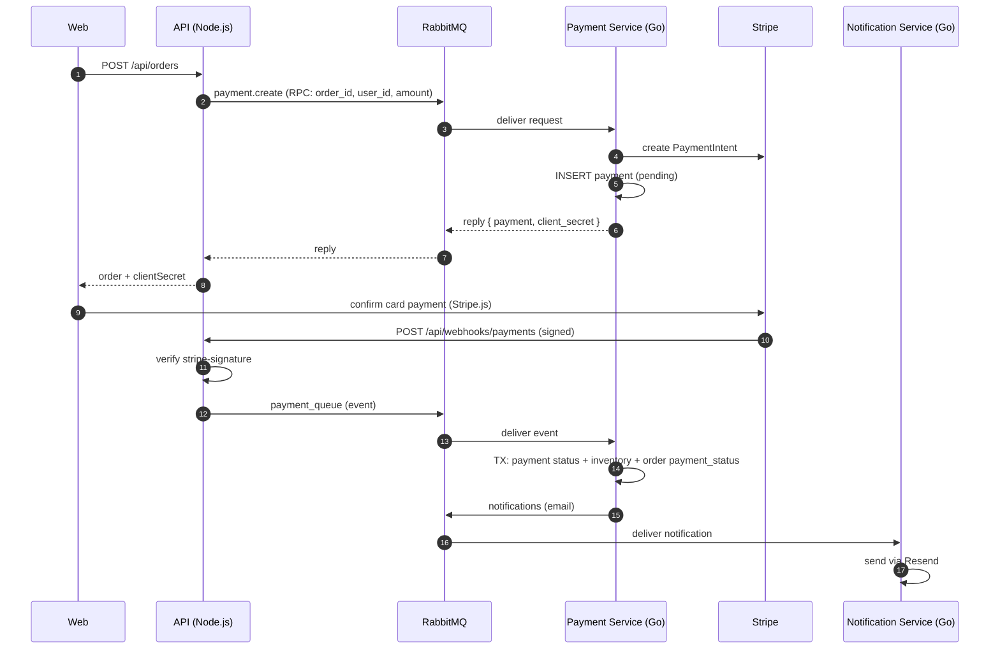

# Scalable E-Commerce Platform

A full-stack e-commerce platform built as a **hybrid architecture**: a
Node.js/TypeScript API owns the core business domain, while the
latency-sensitive and failure-sensitive work (payments and notifications) runs
in dedicated **Go services** connected through **RabbitMQ**.

It is intentionally *not* a pure microservices system. All data-owning services
share **one PostgreSQL database**, which keeps payment, order and inventory
updates inside a single ACID transaction instead of a distributed saga.

---

## Table of Contents

- [Highlights](#highlights)
- [Architecture](#architecture)
- [Services at a Glance](#services-at-a-glance)
- [Why a Hybrid Architecture?](#why-a-hybrid-architecture)
- [Payment Flow](#payment-flow)
- [Messaging Contracts](#messaging-contracts)
- [Data Ownership](#data-ownership)
- [Technology Stack](#technology-stack)
- [Ports](#ports)
- [Quick Start](#quick-start)
- [Running Without Docker](#running-without-docker)
- [Repository Layout](#repository-layout)
- [Reliability Guarantees](#reliability-guarantees)
- [Security Notes](#security-notes)
- [Known Limitations](#known-limitations)

---

## Highlights

- **Storefront**: Next.js 16 (App Router) with cart, checkout, order history and
  Stripe payments.
- **Core API**: Express + TypeScript with JWT cookie authentication, role-based
  catalog management, carts, orders and addresses.
- **Go payment service**: creates Stripe PaymentIntents and applies payment,
  order and inventory changes in one database transaction.
- **Go notification service**: consumes a queue and sends transactional email
  through Resend.
- **RabbitMQ** for request/reply (RPC) and event delivery between the API and
  the Go services.
- **Idempotent webhook handling**, durable queues and persistent messages.
- **One command to run everything** with Docker Compose.

---

## Architecture



**Key rules of the design**

- The **web** app talks only to the **API**, over REST, using HTTP-only
  cookies. It never talks to the Go services.
- The **API** verifies Stripe webhook signatures and forwards work over
  RabbitMQ. It does **not** create PaymentIntents, write payment rows or update
  inventory.
- The **payment service** owns Stripe, payment records, order payment status and
  inventory changes.
- The **notification service** is a stateless downstream consumer. Email
  delivery is best-effort and can never block an order.

---

## Services at a Glance

| Service | Path | Language | Responsibility |
| --- | --- | --- | --- |
| **Web** | [`web/`](./web) | Next.js 16, React 19, TypeScript | Customer storefront, checkout UI, Stripe.js payment confirmation. |
| **API** | [`api/`](./api) | Node.js, Express, TypeScript | Auth, catalog, carts, orders, addresses, Stripe webhook signature verification, payment RPC client, database migrations. |
| **Payment Service** | [`services/payment/`](./services/payment) | Go | Creates Stripe PaymentIntents; applies payment status, inventory and order updates from RabbitMQ; publishes notification events. |
| **Notification Service** | [`services/notification/`](./services/notification) | Go | Consumes the `notifications` queue and sends transactional email via Resend. |

Each project has its own README with setup, scripts and internals:

- [API README](./api/README.md)
- [Web README](./web/README.md)
- [Payment Service README](./services/payment/README.md)
- [Notification Service README](./services/notification/README.md)

---

## Why a Hybrid Architecture?

| Decision | Reasoning |
| --- | --- |
| **Node.js/TypeScript for the core API** | Fast iteration on the business domain (auth, catalog, carts, orders) with types shared in spirit with the Next.js frontend. |
| **Go for payment and notifications** | Payments are the most failure-sensitive path in the system, and Go gives small, fast, strongly typed workers that are easy to run and reason about as queue consumers. |
| **RabbitMQ between them** | Decouples the API from Stripe latency and email delivery. Durable queues and persistent messages survive restarts. |
| **One shared PostgreSQL database** | Payment status, inventory and order status change together in **one transaction**. There is no need for sagas, compensating actions or eventual consistency for the money path. |
| **Not full microservices** | A database per service would add operational and consistency complexity this system does not need. The trade-off is explicit: services are coupled through the schema (see [Data Ownership](#data-ownership)). |

---

## Payment Flow



---

## Messaging Contracts

All queues are **durable** and all messages are **persistent**.

| Queue | Direction | Payload |
| --- | --- | --- |
| `payment.create` | API → Payment (RPC) | `{ "order_id", "user_id", "amount" }` plus AMQP `reply_to` / `correlation_id` |
| `payment_queue` | API → Payment (events) | `{ "paymentIntent": { "id", "metadata": { "order_id", "user_id" } }, "status", "event_id", "event_type" }` |
| `notifications` | Payment → Notification | `{ "email", "subject", "body" }` |

- RPC calls from the API time out after **15 seconds** and surface as a
  `504`/`502` API error.
- Full contracts live in the
  [Payment Service README](./services/payment/README.md#queues) and the
  [Notification Service README](./services/notification/README.md#message-format).

---

## Data Ownership

The API, payment service and PostgreSQL share a single database, so ownership
is defined by convention. Keep these boundaries when changing the schema.

| Concern | Owner |
| --- | --- |
| Schema and migrations (`api/migrations/`) | **API** |
| Users, roles, catalog, carts, addresses, order creation | **API** |
| Payment rows, payment status | **Payment service** |
| Inventory decrements on successful payment | **Payment service** |
| Order `payment_status` updates | **Payment service** |
| Email delivery | **Notification service** (stateless, no database access) |
| Caching / session infrastructure | **API** (Redis) |

> Any schema change that touches payments, orders or inventory must be checked
> against both the API and the Go payment service.

---

## Technology Stack

| Layer | Technologies |
| --- | --- |
| **Frontend** | Next.js 16 (App Router), React 19, TypeScript, Tailwind CSS v4, Redux Toolkit, Jotai, SWR + axios, Joi, Stripe.js, GSAP |
| **API** | Node.js, TypeScript, Express, `postgres` client, JWT (HTTP-only cookies), Multer, S3-compatible storage |
| **Go services** | Go, `amqp091-go` (RabbitMQ), Stripe Go SDK (payment), Resend Go SDK (notification) |
| **Infrastructure** | PostgreSQL, Redis, RabbitMQ, Docker Compose |
| **Third parties** | Stripe (payments), Resend (email) |

---

## Ports

| Service | Port |
| --- | --- |
| Web (Next.js, `npm run dev`) | `3000` |
| Web (Docker Compose, host-published) | `3090` |
| API (Express) | `8090` |
| PostgreSQL (host) | `5433` |
| Redis | `6379` |
| RabbitMQ | `5672` (AMQP), `15673` (management UI, host) |

Published host ports can be overridden with each service's `*_HOST_PORT`
variable (for example `POSTGRES_HOST_PORT` or `RABBITMQ_AMQP_HOST_PORT`).
Containers keep talking to each other on Compose's internal network using their
normal container ports.

---

## Quick Start

The fastest way to run the whole platform is Docker Compose.

**1. Add secrets**

| File | Purpose |
| --- | --- |
| `secrets/api.env` | API and payment service credentials (database, JWT, Stripe, storage). The payment service reuses it for its database and Stripe settings. |
| `secrets/notification.env` | `RESEND_API_KEY` for the notification service. |

**2. Start everything**

```bash
docker compose up -d --build
```

Compose starts the stack in dependency order: PostgreSQL, Redis and RabbitMQ
first, then the payment and notification services, then the API (which waits
for all of them, applies migrations and starts the server), and finally the web
app.

**3. Open the apps**

| URL | What |
| --- | --- |
| `http://localhost:3090` | Storefront |
| `http://localhost:8090/health` | API health check |
| `http://localhost:15673` | RabbitMQ management console |

**4. Create an administrator**

New users receive the `user` role. Promote one explicitly in PostgreSQL:

```sql
UPDATE users SET role = 'admin' WHERE email = 'admin@example.com';
```

---

## Running Without Docker

The projects are installed and run separately. The recommended order is:
**infrastructure → payment service → notification service → API → web**.

### 1. Payment service

```bash
cd services/payment
cp .env.example .env     # set DATABASE_URL (or DB_*), RABBITMQ_URL, STRIPE_SECRET_KEY
go test ./...
go run ./cmd/server      # consumes payment_queue and payment.create
```

Use `DB_PORT=5433` when connecting to the host-mapped PostgreSQL.

### 2. Notification service

```bash
cd services/notification
cp .env.example .env     # set RESEND_API_KEY and RABBITMQ_URL
go run ./cmd/server      # consumes the "notifications" queue
```

### 3. API

```bash
cd api
cp .env.example .env
npm install
npm run db:migrate
npm run dev              # http://localhost:8090
```

### 4. Web

```bash
cd web
npm install
# .env:
#   NEXT_PUBLIC_API_URL=http://localhost:8090
#   NEXT_PUBLIC_STRIPE_PUBLISHABLE_KEY=pk_test_...
npm run dev              # http://localhost:3000
```

---

## Repository Layout

```text
E-commerce/
├── api/                        # Express + TypeScript REST API
│   ├── migrations/             # SQL migrations (schema source of truth)
│   ├── src/                    # app, modules, config, middleware, lib
│   ├── docker-compose.yaml     # Postgres, Redis, RabbitMQ, API
│   └── Dockerfile
├── web/                        # Next.js storefront
│   └── src/                    # app routes, features, shared, store
├── services/
│   ├── payment/                # Go payment service
│   │   ├── cmd/server/         # entry point
│   │   └── internal/           # config, Stripe gateway, repository, workers
│   └── notification/           # Go email consumer
│       ├── cmd/server/         # entry point
│       └── internal/           # queue consumer + email sender
├── secrets/                    # Compose env files (never committed)
├── docker-compose.yaml         # Full stack
└── README.md                   # this file
```

---

## Reliability Guarantees

- **Durable queues, persistent messages**: RabbitMQ restarts do not lose
  in-flight work.
- **Idempotent webhooks**: status updates are guarded with `status <> $1` inside
  the same transaction as the inventory and order updates, so repeated Stripe
  deliveries are safe.
- **Atomic money path**: payment status, inventory and order payment status
  change in a single database transaction.
- **Safe RPC retries**: if `payment.create` is redelivered after a pending
  payment was already inserted, the existing PaymentIntent is retrieved and its
  client secret returned, with no duplicate intent.
- **No hot redelivery loops**: malformed messages and permanent failures are
  NACKed without requeue.
- **Best-effort email**: a missing user, a failed lookup or a notification
  publish error is logged, and the payment event is still ACKed.
- **Verified webhooks**: the API validates the `stripe-signature` header against
  the raw request body before anything is published.

---

## Security Notes

- Secrets live only in each project's `.env` or in `secrets/` and are never
  committed. Make sure `.env` and `secrets/` are listed in `.gitignore`.
- The web app only holds the Stripe **publishable** key. The secret key stays
  with the Go payment service (`services/payment/.env`, or `secrets/api.env`
  under Compose).
- Authentication uses HTTP-only `accessToken` / `refreshToken` cookies, so no
  token is readable from JavaScript.
- Catalog mutations require the `admin` role, which is loaded from the database
  on every protected operation and never trusted from the client or from stale
  token claims.
- Address data is scoped to the authenticated user.
- Rotate any credential that has ever been shared in plaintext.

---

## Known Limitations

- **Shared database coupling**: the API and payment service depend on the same
  schema, so migrations must be coordinated (see
  [Data Ownership](#data-ownership)).
- **No dead-letter queue** in the notification service: emails that fail to send
  are dropped after one attempt and logged.
- **Placeholder sender address**: the notification service sends from
  `Acme <onboarding@resend.dev>`. Replace it with a verified Resend domain
  before production use.
- **Single RabbitMQ node** in the provided Compose setup.